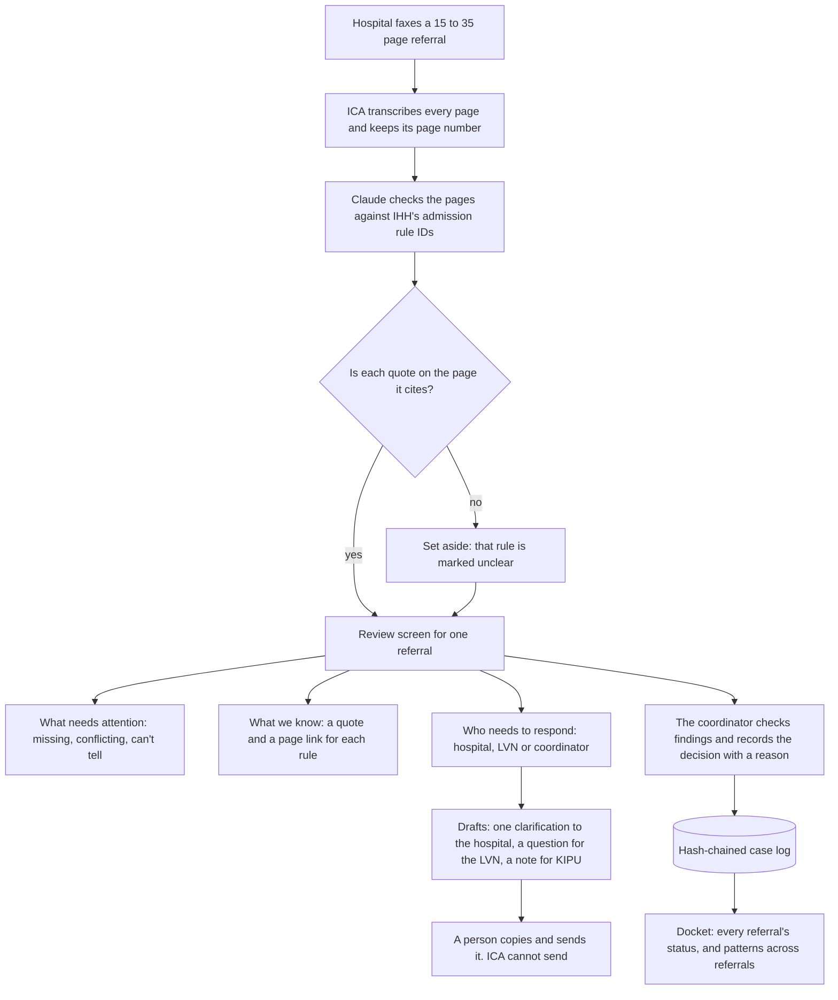
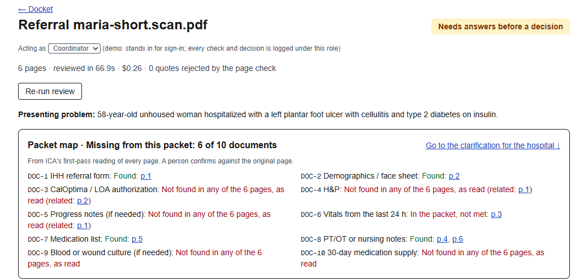

# ICA — Intelligent Care Assistant - Referral Readiness

> For IHH's referral coordinator: ICA turns a faxed hospital referral into what's missing and what
> needs the LVN, with a quote and a page number behind every finding, and turns each open issue
> into one item with an owner. The coordinator decides.

**Team:** Sean (solo)
**Members:** Sean
**Challenge:** 1 Referral intake
**Built at:** Orange County | Claude Impact Lab, October 17, 2026, with Illumination Health + Home

## The problem

IHH's representative at the event estimated that about half of applicants fall out, and about half
of those leave the hospital early. That is their estimate, not an audited figure. Each referral is
15 to 35 faxed pages, read by hand against six pages of criteria with an answer promised within two
hours; the fact that decides it is often deep in the chart, and anything not in the packet is
unknown, not normal. What IHH asked for, in their words: "quick answers to what's missing in a
file", faster correct decisions, and a quicker way through the referral docket.

**Where it gets stuck.** IHH told us the bottleneck is waiting on hospital case managers. ICA's
first pass on IHH's 7 de-identified packets agrees: 125 of the 150 open questions it raised could
only be answered by the hospital (19 by the LVN, 3 by the coordinator). That count is ICA's, not
checked by a person. So ICA asks the hospital for all of them at once.

## What we built

ICA turns a faxed referral into one screen a coordinator can act on in about three minutes, and
leaves every decision with the coordinator.



**The docket.** Every referral in one queue, marked *Ready for your decision*, *Needs answers
before a decision*, or *An exclusion needs review before any decision*. Start a review from an
official packet or upload a de-identified PDF.

**Patterns across the docket.** Counted from ICA's reviews: who the open questions are waiting on,
and the documents most often not in the packet, so the coordinator can ask hospitals for them up
front. It says on screen that it is not checked by a person and not a trained model. Nothing is
sent automatically.

**The review screen, for one referral:**

- **Packet map.** The ten documents IHH requires, at a glance: each one *Found* with its page
  number, *not met* with its page, or *not found in any of the N pages, as read*. It leads with
  "Missing from this packet: K of 10 documents" and a link to the clarification already drafted for
  the hospital, so the ask can go out as soon as the review is done.
- **Every page transcribed.** The packets are image-only faxes. Each page is transcribed on its own
  and keeps its page number; unreadable words are marked `[illegible]` or `[?]`. Every page, as
  read, is one click from "Open original page".
- **What needs attention.** Missing items, conflicts, unreadable pages and anything ICA can't tell,
  each tied to IHH's rule ID. Not in the packet means unknown, not normal. Dates are blacked out in
  these packets, so a rule that needs a date says it cannot be determined.
- **What we know.** For each rule, what ICA found, a short quote and its page number, which opens
  the original page.
- **Who needs to respond.** Open items grouped by who can answer them: the hospital, the LVN
  (conflicts and clinical calls; ICA doesn't pick a side), or the coordinator.
- **Ready to send (you send it; ICA never does).** One *Clarification to the hospital* covering
  every open item, a *Question for the LVN*, and a *Note for KIPU / the EMR* to copy and paste.
  "I sent this" logs that a person sent it.
- **Checked / Wrong on every finding**, logged with the role and the time.
- **Your decision.** Accept, Request info or Decline, with a reason, logged in a hash-chained case
  log. The status at the top is ICA's readiness view, not a decision.
- **Children's referrals.** A patient under 18 gets a banner: IHH's children's criteria apply, and a
  person checks them. ICA checks the adult criteria only.
- **A role menu** (coordinator, LVN, hospital) stands in for sign-in, so every check and decision is
  labeled with a role. It grants no permissions.

**Not built today:** the hospital pre-check ("Prepare"), a status and quick replies on each open
item, and scoring against IHH's 11 decisions. See
[What is real and what is mocked](#what-is-real-and-what-is-mocked).

### How we check it

**Against IHH's 11 decisions: not measured yet.** 7 of the 11 official packets (R01–R07) have been
reviewed end to end; the step that scores ICA's readiness view against IHH's decisions is not
built. A readiness view is not a decision.

**Against the invented demo packet (known answers):** on the 6-page synthetic "Maria" scan, all 10
referral-checklist items (DOC-1 to DOC-10) came out as expected, including vitals older than 24
hours as *not met* and no 30-day supply as *not found*. The mobility conflict (a PT note says
"Transfers: independent", a nursing note says "2-person assist") came out as *conflicting*, routed
to the LVN, with both quotes found on pages 4 and 6. One packet with known answers is a check, not
an accuracy figure.



*The invented demo packet "Maria" (synthetic data). No official packet is shown here.*

**Demo video:** link to add. The public video uses only the invented demo packet.

## How Claude is used

**How we built it.** Built on the day with Claude Code: one session wrote the app in `ica/`, a
second wrote this README and the pitch, and Sean reviewed each step before it was committed. The
night before, Sean used Claude to plan and to generate the invented demo packet (see
[Data and privacy](#data-and-privacy)).

**What Claude does when ICA runs:**

1. Reads each image-only fax page and transcribes it, page by page.
2. Checks the transcription against IHH's official rule IDs from
   [`admission-criteria.json`](challenges/1-referral-intake/criteria/admission-criteria.json) and,
   for each rule, returns a finding with a short quote and its page number.
3. Every quote is then checked against the transcribed text of the page it cites by TrustShell's
   open-source grounding check (Apache-2.0, vendored in this repo). A quote that is not on its
   page, or a wrong page number, is set aside and the rule is marked unclear. This is how ICA keeps
   ground rule 4: no made-up page numbers or quotes. "Quote found" means found in ICA's own
   transcription, not proven against the scan image; the page link opens the original page for a
   person to compare.
4. Drafts, from the checked findings, the clarification to the hospital, the question for the LVN
   and the note for KIPU or the EMR. It never sends anything.

**What a person checks:**

- Each finding, with Checked or Wrong. The grounding check compares a quote with the
  transcription, not the image, so the coordinator opens the page to confirm.
- Every conflict. It stays open until a person resolves it.
- Every clinical judgment, such as medical stability or orientation. ICA shows the evidence; the
  coordinator or the LVN makes the call.
- The decision. Only the coordinator decides, and the decision is logged with the reason.

## Try it

Tested on Windows 11 with Node 22.17 from a fresh clone of this branch: install about 3 minutes,
build about 30 seconds.

| What | Value |
|---|---|
| Installed | Node.js 20.12 or later (tested with 22.17) and npm. Nothing else |
| Environment variables | `ANTHROPIC_API_KEY`, in a `.env` file at the repo root (copy `.env.example`; git ignores `.env`), or set in your shell. Never commit it |
| Packets | Download the 11 packets from the event's Google Drive into `challenges/1-referral-intake/packets/` ([how](challenges/1-referral-intake/README.md)). ICA reads them in place. Without them you can still upload a de-identified PDF |
| Start | `npm run dev -- -H 127.0.0.1` in `ica/` (the `-H 127.0.0.1` keeps it on your laptop only; see [Data and privacy](#data-and-privacy)) |
| Open | http://127.0.0.1:3000 |

```bash
git clone https://github.com/DealAppSeo/ihh-ica.git
cd ihh-ica
cp .env.example .env          # then put your Anthropic API key after ANTHROPIC_API_KEY=
cd ica
npm ci
npm run dev -- -H 127.0.0.1   # open http://127.0.0.1:3000, pick a packet or upload a PDF, Start review
# optional, with the app running: review all 11 official packets, two at a time
bash scripts/run-all.sh
```
Measured today: official packets of 18 to 34 pages took 168 to 214 seconds each to transcribe and
review (two running at once), and the 6-page demo packet took 67 seconds.

## What is real and what is mocked

Status as of 1:50 PM on the event day, from the code on this branch and today's runs (7 official
packets and the demo packet). "Built" means it is in the app but nobody from IHH has used it yet.

| Part | Status |
|---|---|
| Prepare: hospital pre-check (guidance only) | Not built |
| Docket view | Working: the home page lists each referral as ready for your decision, needs answers, or an exclusion to review |
| Patterns across the docket | Working: counted live from the official-packet reviews (who they wait on, documents most often missing); not checked by a person, not a trained model |
| Packet map | Working: built from the review's own findings, with no extra AI call; each required document's page, or "not found in any of the N pages, as read" |
| Transcription of image-only faxes | Working: every page of 7 official packets (14 to 34 pages) and the demo packet; unreadable words are marked `[illegible]` or `[?]` |
| Box 1: What's missing | Working, shown under "What needs attention" |
| Box 2: Needs LVN review (conflicts, clinical calls) | Working: conflicts and clinical calls are owned by the LVN in "Who needs to respond", with a "Question for the LVN" draft |
| Box 3: What we know, with pages and "can't tell" | Working: each rule with its quote and page; a rule that needs a blacked-out date says it cannot be determined |
| Box 4: clarification draft | Working, drafted only. A person copies and sends it, and can log "I sent this" |
| Box 4: copy-ready case note | Working, copy and paste only ("Note for KIPU / the EMR") |
| Box 4: coordinator decision log | Working: the decision and its reason are logged with role and time in a hash-chained case log |
| Quote check against the cited page | Working, against the transcribed text of that page (not the image) |
| Checked / Wrong on each finding | Built: buttons on every finding, logged with role and time |
| Coordinate: one item per open issue, with owner and status | Partly working: open items are grouped by owner (hospital, LVN, coordinator); no per-item status or quick replies yet |
| Role views | Mocked: a role menu stands in for sign-in and labels who checked or decided; it grants no permissions |
| Children's referrals | Banner only: a patient under 18 is flagged so the coordinator applies IHH's children's criteria by hand. ICA checks the adult criteria only |
| Eval against IHH's 11 decisions | Not built: `scripts/run-all.sh` runs the reviews; scoring them against `decisions.json` is not built |
| Instructions hidden inside a fax | Not handled yet, and not tested: nothing yet tells the model to ignore text in a packet that tries to instruct it |
| Sign-in and access control | None: run it on your own laptop only (see [Data and privacy](#data-and-privacy)) |
| Sending anything to a hospital | Not built, by design |
| Connection to any IHH system | None, by design |

## Where it gets things wrong

What it missed on the official packets is not measured yet: that needs the scoring step against
IHH's decisions, and a person reading the findings against the pages.

| What we saw | How often, and on what | What we would do |
|---|---|---|
| A rule can come back "not found" even though a quote for it was found: MOB-1 (walks 100 feet) said "not found" while page 4's "ambulated 40 ft" passed the quote check. It should read "not met" | Once, on the demo packet | Fix the rule's state in the review step; meanwhile the coordinator reads the quote, not just the label |
| The API has no sign-in: anyone who can reach the app can read the packets and transcripts it has seen | By design for a laptop demo | Run on 127.0.0.1 only; for any shared or phone demo, run a separate copy that has seen only the invented packet; add sign-in before any pilot |
| Text inside a packet that tries to instruct the AI is not screened | Not tested | Tell the model to treat packet text as data, screen pages for injected instructions, and test with a poisoned packet |
| A misread page can still pass the quote check, because the check compares against the transcription, not the image | Known by design | The coordinator opens the page before relying on a finding |
| IHH's children's criteria are not covered | Any packet for a patient under 18 | ICA shows a "Children's program" banner so the coordinator reviews it against the children's criteria by hand |
| Rules that need a date or a count of hours, such as INF-2, CARD-1, DOC-6 and DM-3, cannot be checked on these packets | Every packet: the dates are blacked out | ICA says "can't tell from this packet" and puts the item in the clarification draft |

**What we would not trust it with yet:** making the decision, any clinical judgment, or any finding
that no person has checked against the page.

## Next steps

**To pilot it:** a 30-day shadow pilot. ICA reviews each referral alongside the coordinator, the
coordinator decides exactly as today, and we measure, rule by rule, how often they agree. ICA is
designed for HIPAA, not certified: before any real referral it would need IHH's IT and compliance
sign-off and a BAA covering the model provider and the host.

**Fitting IHH's systems:** IHH told us their team communicates by email and fax and works in KIPU
(their CRM) and an EMR. Today ICA connects to none of them (ground rule 2) and gives a copy-ready
note instead. Integration with KIPU or the EMR comes later, with IHH's permission.

**With one more week:** the plan is in [pitch/VISION.md](pitch/VISION.md), "The Care Coordination
Bridge": an installable phone app for hospital and IHH roles, trust earned per rule from measured
agreement, a morning brief for the coordinator, and the moments after the yes.

## Data and privacy

This project uses only data from the event repo and public sources. It contains no real
patient or client information. It does not connect to any Illumination Health + Home system.

- The 11 official packets are de-identified real referrals. ICA reads them in place from
  `challenges/1-referral-intake/packets/`, which git ignores. They are never copied into this repo,
  and the public demo video does not show them.
- The demo packet "Maria" is invented. It was generated the night before the event so a public
  recording could be made without showing a real packet. Every page is marked as synthetic test
  data.
- IHH's decisions (`challenges/1-referral-intake/eval/decisions.json`) are used only to score ICA
  after a review. The review step never reads them.
- API keys live in a local env file that git ignores.
- **Run it on your own laptop only.** The app has no sign-in, and its API returns the packets and
  transcripts it has read. Start it with `-H 127.0.0.1` so the venue network can't reach it, and
  never tunnel or deploy a copy that has read the official packets. For a phone or public demo,
  run a separate clone that has seen only the invented demo packet.
- Scope: adult recuperative-care referrals only. ICA does not evaluate IHH's children's criteria
  and does not make clinical eligibility decisions.

**Credit:** quote checking uses `ground.ts` from TrustShell (Apache-2.0), vendored with its license
header.

## License

[MIT](LICENSE). The vendored TrustShell file (`ica/lib/ground.ts`) keeps its Apache-2.0 license:
its header, [`ica/NOTICE`](ica/NOTICE) and the full license text in
[`ica/LICENSES/Apache-2.0.txt`](ica/LICENSES/Apache-2.0.txt). IHH's admission criteria and referral
form remain IHH's documents.
